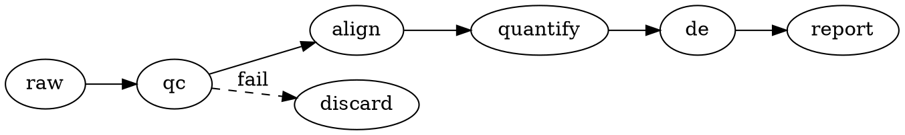

# Scientific Schematics

A schematic is an argument in pictures. It is not decoration; it is how a reader
sees the design, the mechanism, or the pipeline in one look.

## The decision: generate or draw

| Situation | Route |
|---|---|
| Diagram must be reproducible or version-controlled | Generate (TikZ, matplotlib, Graphviz, Mermaid) |
| Diagram is a one-off concept figure with bespoke layout | Vector tool (Illustrator/Inkscape), keep the source |
| Diagram is a workflow/pipeline | Graphviz, Mermaid, or a flowchart library |
| Diagram is a physical setup | TikZ or a drawing tool with measured proportions |
| Diagram is a molecular mechanism | `molecular-visualization` first, schematic only for the cartoon |

**Do not hand-draw data.** A schematic shows structure and relationships; any
quantity it shows must come from the actual result.

## TikZ (LaTeX-native)

```latex
\begin{tikzpicture}[node distance=1.5cm, auto,
    block/.style={rectangle, draw, fill=blue!15, text width=6em, align=center}]
  \node[block] (input) {Input data};
  \node[block, right of=input] (prep) {Preprocess};
  \node[block, right of=prep] (model) {Model};
  \node[block, right of=model] (out) {Prediction};
  \draw[->] (input) -- (prep);
  \draw[->] (prep) -- (model);
  \draw[->] (model) -- (out);
\end{tikzpicture}
```

Advantages: compiles with the document, consistent fonts, scales losslessly.

## Graphviz / Mermaid (workflows)



Good for branching pipelines and DAGs. Bad for physical setups and anything
requiring precise geometry.

## matplotlib (data-aware schematics)

Use when the schematic needs to be generated alongside real numbers — e.g. a
diagram whose box sizes or positions encode actual quantities. Keep the script.

## Composition rules

- **Left-to-right or top-to-bottom flow.** Do not make the reader backtrack.
- **Consistent shape language:** rectangles = processes, rounded = data,
  diamonds = decisions, cylinders = storage. Pick a convention and keep it.
- **Labels are short and aligned.** A box with a paragraph is a slide, not a
  schematic.
- **Line weight hierarchy:** flow arrows heavier than annotation lines;
  connectors that matter are solid, optional ones dashed.
- **White space.** Boxes that touch read as one object.
- **One level of detail.** A schematic that shows both the architecture and the
  implementation confuses both.

## Color

- Use color to group or to highlight, not to decorate.
- A single accent color for the element the caption is about.
- Colorblind-safe; verify the figure works in grayscale.

## Before shipping

- [ ] The reading direction is obvious in 5 seconds.
- [ ] Every label is legible at final size.
- [ ] Shape and line conventions are used consistently.
- [ ] The diagram does not contradict the text or the data.
- [ ] Source file (TikZ / .dot / script) is saved with the project.
- [ ] Rendered output checked at the size it will be published.
